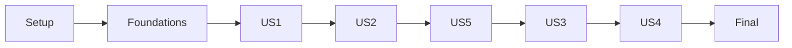

# Tasks: Registro de usuarios de KynWallet

**Input**: documentos de `specs/002-registro-billetera/`: [spec](spec.md), [plan](plan.md), [research](research.md), [modelo](data-model.md), [API ficticia](contracts/registration-api.md), [UI](contracts/ui-registration.md) y [quickstart](quickstart.md).

**Prerequisites**: Constitución 1.0.0 y aclaración confirmada: «Regístrate» abre `/register`; «Inicia sesión» vuelve a `/login`.

**Tests**: obligatorias por solicitud del usuario y Constitución I. Cada cambio de comportamiento se inicia con prueba roja, luego implementación y refactorización sin alterar comportamiento. Prefijos `REG-USn-m` y FR para trazabilidad. Estado actualizado durante implementación; las tareas con evidencia externa o gates pendientes conservan casilla vacía.

**Organization**: setup → fundamentos compartidos → US1 (P1) → US2 (P1) → US5 (P1) → US3 (P2) → US4 (P2) → validación transversal. Se mantienen los IDs de historias de la especificación aunque el orden por prioridad sea distinto.

## Format: `[ID] [P?] [Story] Description`

`[P]` identifica tareas ejecutables en paralelo con otra tarea indicada, únicamente después de satisfacer sus dependencias y sin editar los mismos archivos. No autoriza omitir pruebas previas. Las tareas de fases de historia llevan `[USn]`; las compartidas no.

## Path Conventions

Proyecto único existente; rutas relativas a la raíz. Código en `src/`, pruebas junto al módulo (`*.test.ts(x)`). No crear un segundo proyecto, backend, base de datos ni servidor de mocks. Los archivos de evidencia bajo este feature se crean durante implementación y no contienen datos personales ni capturas con datos reales.

## Phase 1: Setup (Shared Infrastructure)

**Purpose**: preparar el proyecto existente y conocer su línea base sin sobrescribir cambios del usuario.

- [x] T001 Verificar disponibilidad de Node 22.12+ y npm, contrastar engines con `package-lock.json`, ejecutar `npm ci` si hace falta y registrar versiones/bloqueos reales en `specs/002-registro-billetera/validation.md`; conservar las versiones bloqueadas de `package.json` y no recrear Vite.
- [x] T002 Ejecutar suite actual, cobertura y controles locales de `package.json`; registrar resultados base y porcentajes de `vite.config.ts` en `specs/002-registro-billetera/validation.md`, distinguiendo fallos previos y sin deshabilitar pruebas o controles.
- [x] T003 [P] Preparar la matriz de evidencia FR-001–FR-016 y SC-001–SC-007 en `specs/002-registro-billetera/validation-matrix.md`, incluyendo IDs de escenarios, pruebas previstas y revisiones manuales; marcar resultados como pendientes y registrar que la aprobación de contraste aún no consta.

**Checkpoint**: herramientas utilizables y línea base registrada; T003 puede avanzar junto a T001/T002 porque escribe otro archivo.

## Phase 2: Foundational (Blocking Prerequisites)

**Purpose**: definir contratos y una fuente única de reglas antes del envío o presentación. La validación de negocio compartida se ubica aquí para que US1 nunca acepte datos inválidos; US2 completa su interacción inline.

- [x] T004 Definir tipos sin efectos en `src/domain/registration.ts` y puerto en `src/application/ports/RegistrationGateway.ts`: valores iniciales de cadenas vacías y false; request sin confirmación con `acceptedTerms: true`; resultados `validation-error` con errores, `created` sin identidad ni sesión y `unavailable`; respuesta fake 201/created o 503/unavailable; evento diagnóstico limitado a nombre, categoría, duración numérica y contador.
- [x] T005 [P] Escribir pruebas rojas de validación en `src/domain/registrationValidation.test.ts` (FR-002–005) con restricciones literales del modelo: nombre «trim para validar; 1–100 caracteres; admitir Unicode, espacios internos, tildes, guiones y apóstrofos»; correo «normalizar con regla compartida del login; ≤254; parte local, arroba y dominio con extensión; sin espacios interiores»; password «8–128 caracteres; no recortar; reglas compartidas de longitud»; confirmación «8–128 caracteres; coincidencia exacta con password»; términos «debe ser true para continuar; inicialmente false»; probar vacíos, tipos incorrectos, 100/101, 254/255, 7/8/128/129 y `string.length`.
- [x] T006 [P] Añadir pruebas de regresión en `src/domain/validation.test.ts` para reutilización de correo/contraseña y normalización sin cambiar resultados del login; hacer fallar cualquier contrato nuevo antes de refactorizar `src/domain/validation.ts`.
- [x] T007 Exportar o extraer únicamente las reglas necesarias de `src/domain/validation.ts`, manteniendo comportamiento y constantes del login; implementar `src/domain/registrationValidation.ts` con prioridad obligatorio→formato/longitud→coincidencia, mensajes de límites explícitos, confirmación vacía como obligatoria y comprobación de tipos; centralizar textos nuevos en `src/domain/messages.ts` hasta pasar T005/T006.
- [x] T008 Crear dobles reutilizables sin datos reales en `src/test/registrationStub.ts`: resultados éxito/error, promesa diferida, secuencia error→éxito y captura limitada de llamadas de pruebas; mantener dominio sin React ni dependencias externas y verificar reglas de capas en `eslint.config.js` sin relajarlas.

**Checkpoint**: contratos estables y reglas probadas; todas las historias requieren T004–T008. T005 y T006 son paralelas tras T004 y escriben archivos distintos.

## Phase 3: User Story 1 - Completar un registro de demostración (Priority: P1) — MVP del recorrido

**Goal**: formulario, envío asíncrono seguro y éxito transitorio en login, con bloqueo de entradas inválidas desde el dominio compartido.

**Independent Test**: abrir `/register`, completar datos ficticios válidos y aceptar términos; enviar con botón o Enter; verificar carga, único intento, `/login`, mensaje exacto y ausencia de cuenta/persistencia. Inyectar error y repetir con éxito.

### Tests for User Story 1 — ejecutar en rojo antes de implementar

- [x] T009 [P] [US1] Escribir pruebas contractuales en `src/infrastructure/FakeRegistrationGateway.test.ts` según `contracts/registration-api.md`: demora 500 ms, respuestas exactas 201/created y 503/unavailable, configuración determinista, sin fetch/XHR, sin almacenamiento, sin cuenta persistida ni payload en respuesta; usar temporizadores falsos.
- [x] T010 [P] [US1] Escribir pruebas rojas en `src/application/register.test.ts`: validar antes de delegar, normalizar nombre/correo y conservar password, omitir confirmación, aceptar solo 201/created o 503/unavailable, mapear excepción/respuesta corrupta a unavailable y observar solo eventos seguros; fallo del observador no debe romper respuesta ni filtrar excepción (FR-007–009, FR-016).
- [x] T011 [P] [US1] Escribir pruebas rojas del reducer/hook en `src/ui/features/registration/registrationReducer.test.ts` y `src/ui/features/registration/useRegistrationForm.test.tsx`: estados «editing | submitting | failed», guardia síncrona, campos bloqueados durante envío, error→reintento exitoso, conservación solo en fallo, limpieza y resultado tardío ignorado tras desmontaje.
- [x] T012 [P] [US1] Escribir pruebas rojas en `src/ui/features/registration/RegistrationForm.test.tsx` y `src/App.test.tsx` para REG-US1-1–5: valores iniciales, envío con botón/Enter, un solo intento, mensaje exacto, ruta/render sincronizados, acceso directo, `/` como login, fallback desconocido, popstate y recarga simulada sin datos/éxito restaurados; conservar regresiones de autenticación del login.

### Implementation for User Story 1

- [x] T013 [US1] Implementar `src/infrastructure/FakeRegistrationGateway.ts` con puerto de T004, demora y resultado inyectados; simular el POST lógico sin endpoint ni llamada HTTP y liberar solicitud tras resolver; pasar T009.
- [x] T014 [US1] Implementar `src/application/register.ts` con gateway/observer inyectados, validación común, construcción mínima de request, validación runtime de respuestas y manejo explícito de excepciones; devolver las tres variantes previstas sin datos personales y pasar T010.
- [X] T015 [US1] Implementar `src/ui/features/registration/registrationReducer.ts` y `src/ui/features/registration/useRegistrationForm.ts`: transiciones del modelo, guardia inmediata de intento único, estado ocupado, desbloqueo en fallo y descarte de respuestas al abandonar; pasar T011 sin copiar reglas del dominio.
- [X] T016 [US1] Crear `src/ui/features/registration/RegistrationForm.tsx` reutilizando TextField, PasswordField, Checkbox, Button, Divider y SocialButton: cuatro etiquetas/textos de referencia, `new-password` en ambas contraseñas, términos inicialmente false, `noValidate`, preventDefault, envío válido y aviso «Demostración: no se creará una cuenta real. Usa datos ficticios»; presentar fallo genérico y recuperación sin perder valores.
- [X] T017 [US1] Crear `src/ui/features/registration/RegistrationScreen.tsx` y composición mínima en `src/ui/features/registration/RegistrationScreen.module.css` y `src/ui/features/registration/RegistrationForm.module.css`, con un main/encabezado claro, flujo vertical y ancho flexible; reservar réplica visual completa para US5 sin introducir posiciones absolutas de formulario.
- [X] T018 [US1] Implementar rutas `/register`, `/login`, alias `/` y fallback replace a `/login` en `src/App.tsx`, escucha/limpieza de popstate y navegación explícita; mantener éxito solo en estado volátil de App, nunca query, history.state ni almacenamiento; mostrar «Registro de demostración exitoso. Puedes iniciar sesión con una cuenta de demostración» con role=status y foco/anuncio único, limpiándolo al salir o recargar.
- [X] T019 [US1] Integrar inyección en `src/main.tsx`, configuración pública opcional `VITE_DEMO_REGISTRATION_MODE` en `src/vite-env.d.ts` y ejemplo no sensible en `.env.example`: «success» o ausente significa éxito, «unavailable» o valor inválido significa indisponibilidad controlada; no alterar cuentas/credenciales del login ni consumir servicios.
- [X] T020 [US1] Escribir pruebas rojas del sink en `src/infrastructure/demoDiagnostics.test.ts` para una emisión por intento, contadores/duración y exclusión de datos personales/errores crudos; incluir fallo del sink y verificar que el caso de uso conserva respuesta controlada.
- [X] T021 [US1] Implementar `src/infrastructure/demoDiagnostics.ts`, conectarlo desde `src/main.tsx` y acotar en `eslint.config.js` cualquier permiso de consola al archivo/método de diagnóstico; registrar solo esquema permitido, métricas de duración/resultado y ninguna solicitud; pasar T020.
- [X] T022 [US1] Ejecutar T009–T012/T020 y regresiones del login; verificar carga ≤2 s, cero red/almacenamiento de registro, duplicados, error→éxito y salida durante espera; actualizar la evidencia de US1 en `specs/002-registro-billetera/validation.md` sin afirmar pruebas manuales no realizadas.

**Checkpoint**: US1 se demuestra con URL directa y fake inyectado; US3 conectará el enlace de entrada. No es una entrega final hasta completar validaciones inline, diseño y accesibilidad.

## Phase 4: User Story 2 - Corregir datos y aceptar los términos (Priority: P1)

**Goal**: mostrar y actualizar errores junto al control correcto, conservar entradas y guiar foco.

**Independent Test**: enviar vacío y cada combinación inválida, corregirla sin borrar otros campos; verificar blur/envío, límites, aceptación y revalidación cruzada sin ejecutar gateway.

### Tests for User Story 2

- [X] T023 [P] [US2] Escribir pruebas rojas en `src/ui/components/Checkbox/Checkbox.test.tsx` para nuevas props opcionales ref/error/required/onBlur/disabled y aria-describedby/aria-invalid, preservando etiqueta de texto y comportamiento de «Recordarme» del login.
- [X] T024 [P] [US2] Ampliar pruebas rojas REG-US2-1–8 en `src/ui/features/registration/RegistrationForm.test.tsx` y `src/ui/features/registration/registrationReducer.test.ts`: cinco errores al enviar vacío, ninguno al inicio, blur de control, corrección inmediata de errores visibles, valores preservados, primer foco inválido incluida casilla y coincidencia reevaluada al cambiar cualquiera de las contraseñas.

### Implementation for User Story 2

- [X] T025 [US2] Ampliar `src/ui/components/Checkbox/Checkbox.tsx` y `src/ui/components/Checkbox/Checkbox.module.css` con las props probadas en T023 y asociación estable de error, manteniendo compatibilidad del login; no anidar controles interactivos en label.
- [X] T026 [US2] Completar touched/primer envío, errores derivados y revalidación cruzada en `src/ui/features/registration/registrationReducer.ts` y `src/ui/features/registration/useRegistrationForm.ts`; aplicar la función de dominio de T007, no duplicarla; mantener inputs sin tocar libres de errores antes del primer envío.
- [X] T027 [US2] Integrar mensajes inline, refs y foco al primer error en `src/ui/features/registration/RegistrationForm.tsx`; respetar orden nombre→correo→password→confirmación→términos, no truncar silenciosamente con maxLength y conservar valores al corregir; aplicar textos exactos de US2 y errores explícitos de longitud máxima.
- [X] T028 [US2] Añadir pruebas de interacción REG-US2-7–8 en `src/ui/features/registration/RegistrationForm.test.tsx` con pegado, nombre de espacios, tildes/apóstrofos/guiones, trim de nombre/correo, espacios significativos y mayúsculas en contraseñas, prioridad de error en confirmación vacía y ningún gateway ante invalidez; escribir primero y corregir implementación solo si falla.
- [X] T029 [US2] Ejecutar pruebas de US2 y componentes compartidos/login; registrar escenarios y evidencia FR-002–007 en `specs/002-registro-billetera/validation.md`, comprobando que desmarcar términos vuelve a impedir finalizar.

**Checkpoint**: toda validación solicitada se presenta inline y se puede corregir sin perder datos.

## Phase 5: User Story 5 - Registrarse desde móvil y con ayudas de accesibilidad (Priority: P1)

**Goal**: reproducir la referencia local con composición responsive y cumplir WCAG 2.1 AA sin cambiar el layout del login.

**Independent Test**: comparar escritorio con captura, probar cinco anchos y zoom 200 %, y completar el recorrido con teclado/lector de pantalla, incluidos errores y éxito.

### Tests for User Story 5

- [X] T030 [P] [US5] Escribir pruebas rojas en `src/ui/layout/BrandPanel/BrandPanel.test.tsx` para variante de registro, textos exactos de referencia, tarjeta decorativa y mantenimiento del contenido predeterminado del login.
- [X] T031 [P] [US5] Escribir pruebas rojas contractuales REG-US5-1–5 en `src/ui/features/registration/RegistrationScreen.test.tsx`: estructura/etiquetas/obligatoriedad, recorrido de teclado hasta campos/casilla y submit, foco visible según estilos, errores asociados, estado ocupado y axe en vacío/error; preparar integración del anuncio de éxito en `src/App.test.tsx` sin afirmar que jsdom certifica layout/contraste.

### Implementation for User Story 5

- [X] T032 [US5] Parametrizar `src/ui/layout/BrandPanel/BrandPanel.tsx` y `src/ui/layout/BrandPanel/BrandPanel.module.css` con variante de registro y contenido «Comienza tu camino financiero.»/texto de apoyo exacto del contrato; preservar el valor por defecto del login y tarjeta aria-hidden; pasar T030.
- [X] T033 [US5] Completar `src/ui/features/registration/RegistrationScreen.module.css` y `src/ui/features/registration/RegistrationForm.module.css` según `.prompts/registro/04 · Registro.png` y `.prompts/registro/styles.css`: a 1440×1024 panel 620 px/formulario 400 px en x=820/y≈140, Inter local, campos 52 px/radio 12 px, sociales 48 px, dos paneles desde 1024 y BrandPanel totalmente oculto debajo; ancho mínimo 320 con márgenes 16 px, crecimiento por errores, scroll vertical y estado conservado al resize.
- [X] T034 [US5] Incorporar gradiente de registro `60deg, #FF8A65 31.7%, #EF5226 83.46%` y tokens de estilo necesarios en `src/ui/styles/tokens.css`, aplicando variante sin reemplazar tema del login; medir contrastes de textos/botones/bordes y blanco sobre gradiente, usar variantes AA y documentar cada diferencia en `specs/002-registro-billetera/design-review.md` con referencia a Constitución 8.4/8.6, sin dar aprobación por supuesta.
- [X] T035 [US5] Completar semántica, anuncios de errores/resultados sin repetición por pulsación y foco programático en `src/ui/features/registration/RegistrationForm.tsx`, `src/ui/features/registration/RegistrationScreen.tsx` y `src/App.tsx`; ajustar componentes compartidos solo cuando T031 demuestre necesidad y mantener sus regresiones.
- [ ] T036 [US5] Ejecutar tests/axe de US5 y revisión manual de teclado, lector de pantalla y zoom 200 % siguiendo `specs/002-registro-billetera/quickstart.md`; registrar resultados reales y limitaciones en `specs/002-registro-billetera/accessibility-review.md`, sin cerrar evidencia manual pendiente.
- [X] T037 [US5] Comparar visualmente a 1440×1024 y 320/375/768/1024/1440 px, errores visibles, ventana baja y resize; guardar evidencia sin datos reales en `specs/002-registro-billetera/design-review.md` y actualizar SC-004–006 en `specs/002-registro-billetera/validation-matrix.md`; dejar aprobación de diseño identificada como pendiente si aún no existe.

**Checkpoint**: diseño y accesibilidad verificados en el alcance disponible; toda revisión no realizable queda explícitamente pendiente, nunca marcada como realizada.

## Phase 6: User Story 3 - Usar las acciones secundarias (Priority: P2)

**Goal**: conectar login↔registro y ofrecer respuestas claras de Google, Apple y términos.

**Independent Test**: «Regístrate» abre formulario vacío en `/register`; «Inicia sesión» vuelve a `/login` sin éxito; cada acción secundaria preserva valores y devuelve el foco.

### Tests for User Story 3

- [X] T038 [P] [US3] Escribir pruebas rojas REG-US3-1/4 en `src/App.test.tsx` y `src/ui/features/login/LoginForm.test.tsx` para enlace real «Regístrate» a `/register`, regreso a `/login` sin éxito, descarte de datos, atrás/adelante y conservación de avisos de las demás acciones del login; reemplazar solo expectativas antiguas del aviso de registro.
- [X] T039 [P] [US3] Escribir pruebas rojas REG-US3-2/3 en `src/ui/features/registration/RegistrationForm.test.tsx`: Google/Apple disparan alert exacta «Próximamente», términos informa «Términos y condiciones no disponibles en esta demostración», cero envío/validación implícita, datos/casilla intactos y foco restituido.

### Implementation for User Story 3

- [X] T040 [US3] Convertir «Regístrate» en navegación accesible a `/register` en `src/ui/features/login/LoginForm.tsx`, con integración/callback desde `src/App.tsx` y href real; conservar apertura convencional con modificadores cuando corresponda y todas las demás acciones del login, pasando T038.
- [X] T041 [US3] Implementar «Inicia sesión» como enlace real a `/login` en `src/ui/features/registration/RegistrationForm.tsx`, coordinado con `src/App.tsx`; limpiar estado de registro y no generar aviso de éxito, pasando REG-US3-1.
- [X] T042 [US3] Conectar SocialButton de Google/Apple a `window.alert('Próximamente')` y el botón hermano de términos al aviso del contrato en `src/ui/features/registration/RegistrationForm.tsx`; todos type=button, preservar datos/aceptación y devolver foco; centralizar mensajes en `src/domain/messages.ts` y pasar T039.
- [X] T043 [US3] Ejecutar integración completa login→registro→login y regreso con éxito después de un intento nuevo, más regresiones de acciones del login; registrar FR-010/011/015 y aclaración aceptada en `specs/002-registro-billetera/validation.md`.

**Checkpoint**: la aclaración A está implementada y verificada; las acciones sociales del login conservan su aviso anterior y las del registro usan «Próximamente».

## Phase 7: User Story 4 - Consultar las contraseñas ingresadas (Priority: P2)

**Goal**: controles independientes con nombres accesibles distinguibles para contraseña y confirmación.

**Independent Test**: alternar cada visibilidad dos veces con teclado; comprobar valor, estado, nombre accesible y ausencia de envío/cambio en el otro campo.

### Tests for User Story 4

- [X] T044 [P] [US4] Escribir pruebas rojas en `src/ui/components/PasswordField/PasswordField.test.tsx` para etiqueta de acción configurable, aria-pressed, type=button y conservación del nombre predeterminado del login.
- [X] T045 [P] [US4] Escribir pruebas rojas REG-US4-1/2 en `src/ui/features/registration/RegistrationForm.test.tsx` para visibilidad inicial oculta, independencia de ambas instancias, valores sin cambios, activación por teclado y reinicio oculto al desmontar/reabrir registro.

### Implementation for User Story 4

- [X] T046 [US4] Ampliar mediante props opcionales `src/ui/components/PasswordField/PasswordField.tsx` para nombres «Mostrar/Ocultar contraseña» y «Mostrar/Ocultar confirmar contraseña»; mantener estado local por instancia, icono existente decorativo y compatibilidad del login; conectar ambas instancias en `src/ui/features/registration/RegistrationForm.tsx` y pasar T044/T045.
- [X] T047 [US4] Ejecutar pruebas de US4, axe y regresiones del campo de login; registrar FR-012 y operabilidad final de estos controles en `specs/002-registro-billetera/validation.md` y `specs/002-registro-billetera/accessibility-review.md`.

**Checkpoint**: las cinco historias tienen incrementos verificables y no comparten accidentalmente estado de visibilidad.

## Phase 8: Polish & Cross-Cutting Concerns

**Purpose**: cerrar evidencia, documentación y controles sin ampliar alcance.

- [X] T048 [P] Actualizar `README.md`, `package.json` (solo engines si el requisito real lo exige) y `specs/002-registro-billetera/quickstart.md` con comandos locales, Node/npm compatibles, `/register`, `/login`, enlace conectado, configuración fake éxito/error, reinicio de Vite, fallback SPA y ausencia de cuentas reales/APIs; no incluir código de implementación en quickstart ni sobrescribir `.env.local`.
- [X] T049 [P] Revisar cobertura de escenarios y FR en `specs/002-registro-billetera/validation-matrix.md` con enlaces a pruebas concretas y evidencia manual; comprobar FR-009/016 con DevTools y pruebas de red/almacenamiento/diagnósticos, incluyendo inputs con apariencia ejecutable tratados como texto y repetición del correo sin unicidad persistente; crear primero prueba de regresión para cualquier defecto encontrado.
- [ ] T050 Ejecutar `npm run verify` de `package.json`, auditoría de licencias también de desarrollo sin `--production` usando herramienta ya instalada, y formato explícito de documentos excluidos; comparar cobertura final con T002 (≥80 % en las cuatro métricas y sin disminución global), registrar resultados en `specs/002-registro-billetera/validation.md` y corregir hallazgos nuevos sin bajar umbrales ni excluir archivos para ocultarlos.
- [X] T051 Validar build/preview y apertura directa/recarga de `/register` y `/login`, volver atrás/adelante, flujo completo y resultado ≤2 s; repetir smoke de login y registrar evidencia de SC-002/003/007 siguiendo `specs/002-registro-billetera/quickstart.md` en `specs/002-registro-billetera/validation.md`; no desplegar ni afirmar validación de hosting remoto no realizada.
- [ ] T052 Realizar prueba de usabilidad SC-001 con cinco participantes y datos ficticios, medir al menos cuatro finalizaciones sin ayuda en menos de dos minutos y comprensión de demo; registrar resultados anónimos o impedimento pendiente en `specs/002-registro-billetera/usability-review.md`, sin simular participantes ni marcar cumplido sin evidencia.
- [ ] T053 Consolidar conformidad constitucional y pendientes en `specs/002-registro-billetera/validation.md` y diferencias visuales en `specs/002-registro-billetera/design-review.md`; registrar aprobación real de diseño para desviaciones y revisión por otra persona antes de integrar (8.6/9.3), solicitar únicamente las aprobaciones aún necesarias sobre resultados concretos y no marcar esta tarea completa mientras falten requisitos de aceptación o aprobaciones exigidas.

## Dependencies & Execution Order

### Phase Dependencies

Setup (T001–T003) → fundamentos (T004–T008) → US1 (T009–T022) → US2 (T023–T029) → US5 (T030–T037) → US3 (T038–T043) → US4 (T044–T047) → cierre (T048–T053).

Este orden prioriza P1 antes de P2 y evita editar el formulario simultáneamente. Las pruebas de cada historia pueden prepararse en paralelo según ejemplos; las historias se integran secuencialmente porque comparten archivos de presentación.

### Dependencies Within Phases

- T001 precede ejecución de T002; T003 es independiente. T004 fija contratos antes de T005/T006; T007 espera ambos y T008 cierra preparación.
- US1: T009/T010/T011/T012 son paralelas tras fundamentos; T013 espera T009; T014 espera T010; T015 espera T011/T014; T016 espera T012/T015; T017 integra T016; T018 espera pruebas App de T012 y T017; T019 compone adaptadores existentes; T020 precede T021; T022 espera todo el incremento. T020 puede escribirse antes, pero no se marca paralelo porque comparte preocupaciones de observador con T010.
- US2: T023/T024 paralelas; T025 espera T023; T026/T027 esperan T024/T025; T028 agrega interacciones nuevas mediante rojo→verde antes de T029.
- US5: T030/T031 paralelas; T032 espera T030; T033/T034 aplican diseño y T035 espera T031; T036/T037 revisan la composición completa de la fase.
- US3: T038/T039 paralelas; T040/T041 cambian navegación secuencialmente; T042 aplica alertas tras T039; T043 valida todo.
- US4: T044/T045 paralelas; T046 espera ambas; T047 verifica integración.
- Cierre: T048/T049 paralelas después de historias, editando archivos distintos; T050/T051 registran validación secuencialmente. T052 requiere participantes disponibles; T053 requiere resultados, revisiones y aprobaciones reales. Las pruebas manuales de controles añadidos en P2 se vuelven a revisar al cierre.

### Parallel Opportunities & Examples per Story

| Historia | Ejemplo de tareas paralelas                                | Condición                                                           |
| -------- | ---------------------------------------------------------- | ------------------------------------------------------------------- |
| US1      | T009 fake, T010 aplicación, T011 reducer/hook, T012 UI/App | fundamentos listos; archivos distintos; pruebas antes de producción |
| US2      | T023 Checkbox y T024 formulario/reducer                    | US1 listo; no mezclar implementación de formulario con estos tests  |
| US5      | T030 BrandPanel y T031 pantalla/axe                        | US2 listo; no editar BrandPanel desde T031                          |
| US3      | T038 navegación/login y T039 acciones del registro         | US5 listo; App.test y RegistrationForm.test en tareas distintas     |
| US4      | T044 PasswordField y T045 integración de dos campos        | US3 listo; contratos compartidos estables                           |

Fuera de historias, T003 puede correr con preparación y T048 con T049. Ningún ejemplo implica lanzar agentes automáticamente ni trabajar en los mismos archivos al mismo tiempo.

## Traceability & Completeness

| Requisitos / resultados     | Tareas principales          |
| --------------------------- | --------------------------- |
| FR-001, FR-013; SC-004/006  | T017, T030–T037             |
| FR-002–005                  | T004–T007, T010, T023–T029  |
| FR-006, FR-007; SC-002      | T011–T016, T023–T029        |
| FR-008/009; SC-003          | T009–T022, T049, T051       |
| FR-010/011/015 y aclaración | T038–T043                   |
| FR-012                      | T044–T047                   |
| FR-014; SC-005              | T023–T027, T030–T037, T047  |
| FR-016                      | T010, T014, T020–T022, T049 |
| SC-001                      | T052                        |
| SC-007 y Constitución       | T002–T003, T048–T053        |

Todos los contratos y entidades del modelo están asignados: valores/errores/request/resultados en fundamentos y US1; estado del formulario en US1/US2; navegación en US1/US3; diagnóstico en US1. Las reglas de campos se citan literalmente en T005. No hay tarea de crear endpoint real, persistir usuarios, validar unicidad contra una base de datos o consumir APIs externas.

## Implementation Strategy

### MVP First

Completar setup, fundamentos y US1 para demostrar el recorrido válido con fake inyectado y URL directa. Es un MVP técnico del flujo, no una entrega que permita omitir las historias P1 de validación/accesibilidad. El mínimo listo para evaluación funcional incluye además US2 y US5; la entrega solicitada requiere las cinco historias, incluidas navegación conectada y visibilidad.

### Incremental Delivery

En cada fase: escribir pruebas y observar fallo → implementar hasta verde → refactorizar → ejecutar regresiones afectadas → registrar evidencia → marcar únicamente tareas realizadas. Incorporar US3 y US4 sin cambiar reglas de autenticación del login. Al finalizar, ejecutar controles completos una vez; repetirlos solo ante cambios o fallos nuevos.

### Completion Constraints

La generación de tareas no ejecuta código ni pruebas y deja todas las casillas vacías. Si faltan herramientas, acceso al navegador, participantes o aprobación de diseño, registrar el bloqueo y completar el trabajo independiente autorizado; no inventar resultados ni considerar cumplidos los criterios. La Constitución requiere revisión externa y aprobación de desviaciones visuales sobre la entrega concreta antes de integrar. No modificar la Constitución ni atribuir al usuario aprobaciones no otorgadas.
